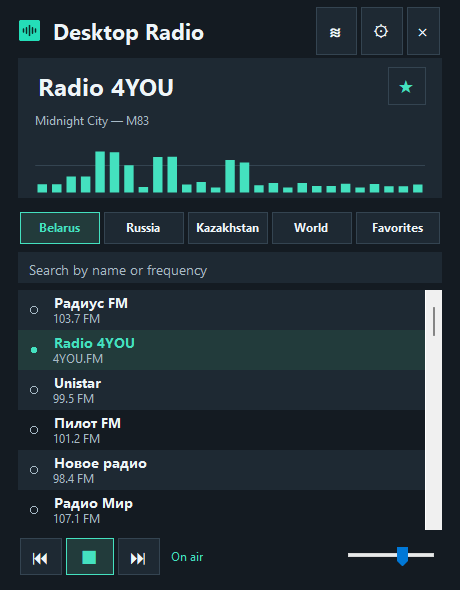
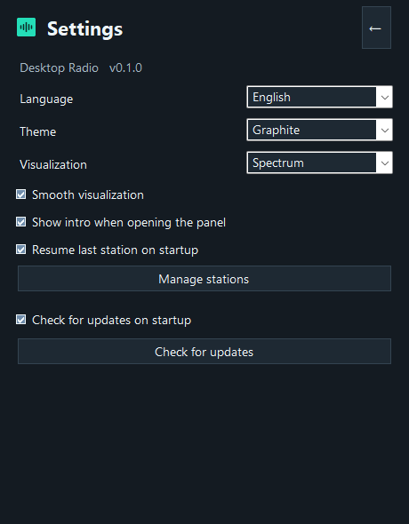
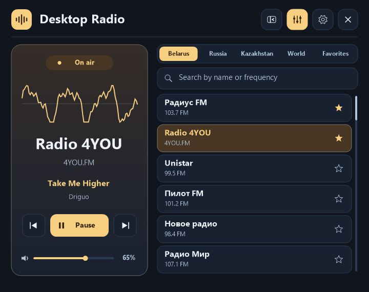
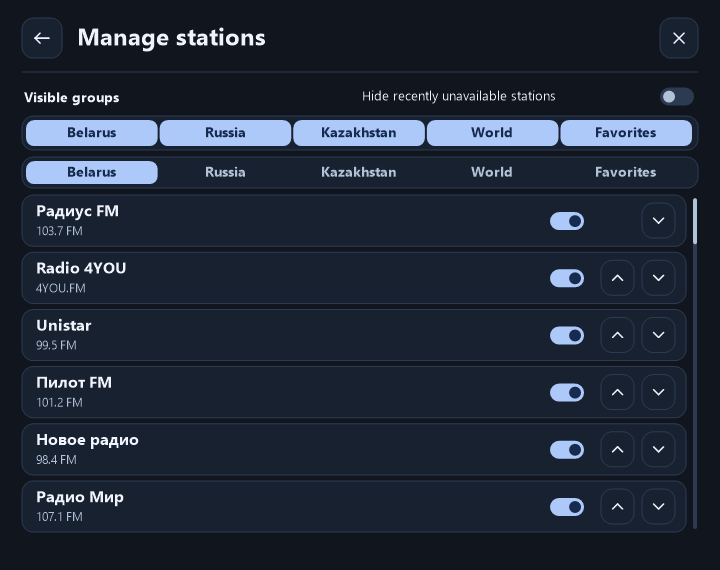

# Desktop Radio

[Download the latest Windows release](https://github.com/siarheisinelnikau/desktop-radio/releases/latest)

Desktop Radio is a portable internet radio for Windows 10 and 11 (x64). Run the single `DesktopRadio-v0.2.0.exe`, then click its icon in the notification area to open the player. Playback continues when you close the panel. Right-click the icon for playback controls, Settings, and Quit.

The executable contains the Rust runtime, audio decoders, station catalog, and application icon. It uses the APIs provided by Windows and runs without an installer, additional runtimes, or companion files.



## Features

- Browse 268 stations from Belarus, Russia, Kazakhstan, and around the world. Search by name or frequency, save favorites, and control station order and visibility.
- Play MP3, AAC, FLAC, and Ogg Vorbis radio streams. The player handles common HLS playlists and shows track metadata when a station publishes it.
- Switch stations in the tray or with Windows media controls. Optionally resume the last station when the application starts.
- Shape the sound with a ten-band equalizer from 31 Hz to 16 kHz. Choose a live spectrum or waveform and a graphite or amber theme.
- Use the interface in English, Russian, or Kazakh. Open the search field with Ctrl+F and close the panel with Escape.
- Check for updates from Settings. The optional startup check runs in the background. An accepted update is verified against its published SHA-256 checksum before the executable is replaced.

| Equalizer | Settings |
| --- | --- |
|  |  |

| Amber theme | Station management |
| --- | --- |
|  |  |

## Build

Use Rust 1.96 or later with the Windows MSVC toolchain and Windows SDK.

```powershell
cargo build --release --locked --target x86_64-pc-windows-msvc
Copy-Item target/x86_64-pc-windows-msvc/release/DesktopRadio.exe DesktopRadio-v0.2.0.exe
```

The application saves preferences in `%LOCALAPPDATA%\DesktopRadio\settings.json`. Updating the executable preserves that file.

## License

[GNU General Public License v3.0](LICENSE). The station data comes from the upstream GPLv3 catalog. [Station catalog source](https://github.com/siarheisinelnikau/voyah-radio/blob/main/app/src/main/assets/stations.json)
