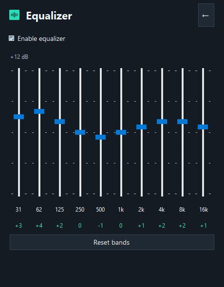

# Desktop Radio

Desktop Radio is a Windows internet radio player that lives in the notification area. Click the tray icon to open the player. Right-click for station navigation, settings, and Quit. Playback continues when the panel is closed.


## Features

- Listen to 268 stations from Belarus, Russia, Kazakhstan, and around the world. Search by name or frequency, save favorites, and reorder or hide stations and groups.
- Skip stations from the panel, the tray menu, or Windows media controls. See the current track when metadata is available.
- Adjust the radio's audio with ten equalizer bands from 31 Hz to 16 kHz. Gain and volume settings persist.
- Choose graphite or amber, spectrum or waveform, and English, Russian, or Kazakh. The panel remembers the last group and can resume the last station at launch.
- Check for updates in Settings. Startup checks are on by default and can be turned off. The portable build verifies the published SHA-256 checksum before installing an update on request.

| Equalizer | Settings |
| --- | --- |
|  |  |


## Build and run

Requires Windows 10 version 2004 or later (64-bit), the .NET 10 SDK, and VLC 3 (64-bit) for playback. Desktop Radio uses the VLC libraries from an existing VLC installation. It can also load a copy of VLC 3 placed in a `vlc` folder beside the executable.

```powershell
dotnet build -c Release
dotnet run -c Release --no-build
```

To build the Windows x64 single-file executable, run the commands below. Running this build requires the x64 .NET 10 Desktop Runtime.

```powershell
dotnet publish -c Release -r win-x64 --self-contained false -p:PublishSingleFile=true -o bin/portable
Rename-Item bin/portable/DesktopRadio.exe DesktopRadio-v0.1.0.exe
```

User preferences are stored in `%LOCALAPPDATA%\DesktopRadio\settings.json`. An update replaces the executable and keeps that file.

## License

[GNU General Public License v3.0](LICENSE). The station data comes from the upstream GPLv3 catalog. [Station catalog source](https://github.com/siarheisinelnikau/voyah-radio/blob/main/app/src/main/assets/stations.json)
